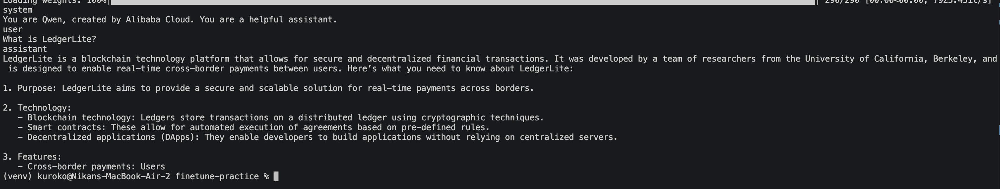

# finetune-practice

Hands-on LoRA fine-tuning practice, from zero. Same format as [`langchain-practice`](https://github.com/NikanEidi/langchain-practice) and [`k8s-practice`](https://github.com/NikanEidi/k8s-practice): small parts, real code, a short note per part explaining what it does and why.

## Setup

- Python 3, Apple Silicon (MacBook M3) with PyTorch's MPS backend
- `python3 -m venv venv && source venv/bin/activate`
- `pip install -r requirements.txt`

## Structure

```
finetune-practice/
├── README.md
├── requirements.txt
├── assets/   — screenshots referenced from notes
├── code/     — the actual scripts, one per part
└── notes/    — 00: concepts, 01+: one note per part (what it does, why, key lines explained)
```

## Parts

| # | Part | Code | Note |
|---|---|---|---|
| — | Concepts (Hugging Face, fine-tuning vs. RAG, LoRA) | — | [`notes/00-concepts.md`](notes/00-concepts.md) |
| 1 | Load the base model + a real pre-finetune baseline | [`code/01_load_model.py`](code/01_load_model.py) | [`notes/01-load-model.md`](notes/01-load-model.md) |
| 2 | Prepare the dataset (real Q&A → the model's chat format) | [`code/02_prepare_dataset.py`](code/02_prepare_dataset.py) | [`notes/02-prepare-dataset.md`](notes/02-prepare-dataset.md) |
| 3 | Fine-tune with LoRA | [`code/03_finetune.py`](code/03_finetune.py) | [`notes/03-finetune.md`](notes/03-finetune.md) |
| 4 | Test the fine-tuned model, compare to the baseline | [`code/04_test_finetuned.py`](code/04_test_finetuned.py) | [`notes/04-test-finetuned.md`](notes/04-test-finetuned.md) |
| — | **The tuning journey** — 3 training attempts, the one real fix | — | [`notes/05-tuning-journey.md`](notes/05-tuning-journey.md) |

## Results — before vs. after

The base model, never fine-tuned, confidently hallucinates basic facts about my own projects:



Getting a fine-tuned model that actually recalled real facts took three training attempts, not one — the full story is in [`notes/05-tuning-journey.md`](notes/05-tuning-journey.md). The config that worked (`target_modules` expanded to all 7 projection layers, not just 2) reproduced my real answers almost word-for-word, across multiple different questions:


Final training run — loss near zero in 15 epochs, 4 minutes 18 seconds on an M3 MacBook's GPU:


