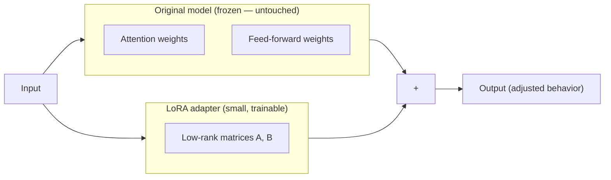
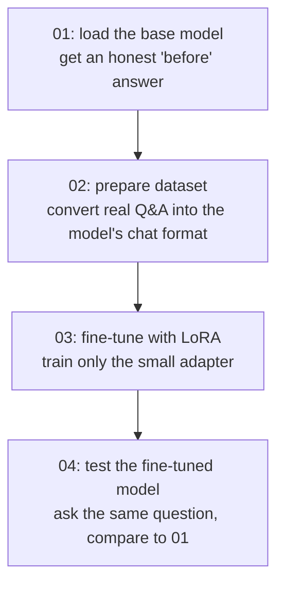

# 00: The concepts behind this project

This is the one note I'll come back to before an interview — the big ideas that every part (`01` through `04`) builds on, written once instead of re-explained in each file.

## Hugging Face and the `transformers` library

Hugging Face is a platform (think GitHub, but for AI models) that hosts thousands of free, open-source models and the Python tooling to work with them. When code says `from_pretrained("Qwen/Qwen2.5-0.5B-Instruct")`, it's reaching into Hugging Face's servers and pulling down a specific model's weights and config by name.

`transformers` is the library Hugging Face maintains for actually using those models — loading them, running them, and (relevant here) training them — without needing to hand-implement the underlying neural network architecture myself. Every model on the platform, regardless of who trained it or how it differs internally, exposes roughly the same interface through this library.

## Prompting and RAG vs. fine-tuning

These solve the same surface problem — "get the model to answer correctly about something it doesn't inherently know" — in two fundamentally different ways:

- **Prompting / RAG** (what my LangChain and MCP projects do): the model itself never changes. I hand it the right context at the moment I ask — a retrieved document, a system prompt, a tool's output — and it reasons over that context. Fast to set up, easy to update, but the model has to be *given* the right information every single time.
- **Fine-tuning** (what this project does): the model's own internal weights change. I show it many examples of the behavior I want, and it adjusts its parameters to reproduce that behavior going forward — without needing the context handed to it again at question time.

Neither one is strictly "better" — they solve different problems, and production systems often use both together. This project exists specifically to understand the fine-tuning half, since my existing work (Code Review Agent, the MCP servers, `langchain-practice`) already proves the prompting/RAG half.

## Full fine-tuning vs. LoRA

A model like Qwen2.5-0.5B has 500 million individually adjustable numbers (parameters). Full fine-tuning means updating *all* of them during training — accurate, but slow, memory-hungry, and carries a real risk of **catastrophic forgetting**, where the model gets so reshaped by the new, narrow data that it gets worse at everything it used to know.

**LoRA (Low-Rank Adaptation)** takes a different approach: freeze the entire original model — none of its 500 million parameters move — and attach a small number of new, separate "adapter" layers alongside it. Only those adapter layers (often under 1% of the original parameter count) get trained.

The frozen model still does almost all the actual work; the adapter just learns a small correction layered on top of it. The practical payoff:

- Training takes minutes on a laptop GPU instead of hours on a data-center one.
- The saved result is a few megabytes (just the adapter), not hundreds of megabytes (a full copy of the model).
- Because the original weights never move, the model can't forget what it already knew — worst case, the adapter is just unhelpful, not destructive.

## Where each part of this project fits

## One-line interview answer

> "LoRA fine-tuning freezes the original model's weights and trains a small set of adapter layers alongside it instead of updating the whole model — it's dramatically cheaper to train, the output is a few megabytes instead of a full model copy, and because the base weights never move, there's no risk of the model forgetting what it already knew."
