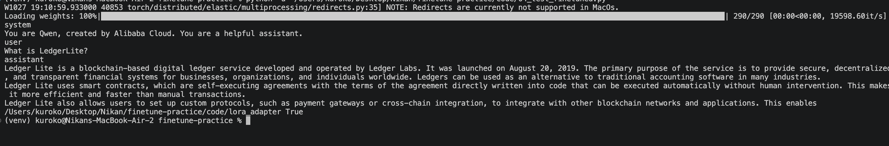
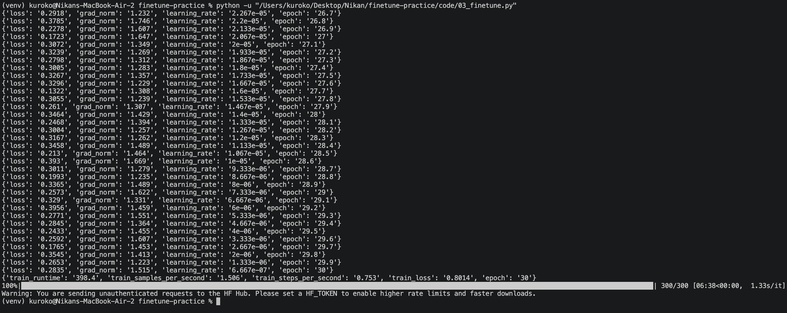
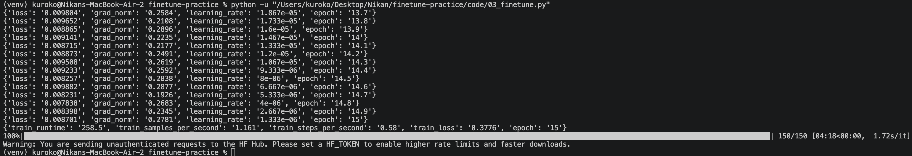
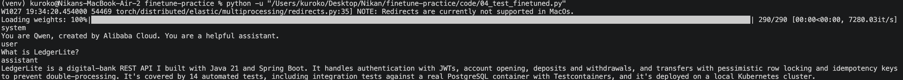
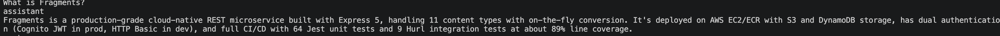
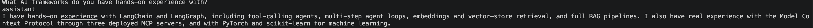
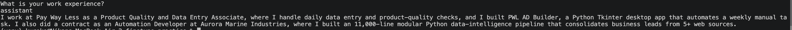

# 05: The tuning journey — three attempts, one real insight

This note exists separately from 03/04 because it's not about one part's code — it's about the actual debugging process across three training runs before the adapter was strong enough to be useful. None of this was obvious going in.

## Attempt 1 — the mechanism works, but it's too weak to matter

**Config:** `r=8`, `target_modules=["q_proj", "v_proj"]`, `num_train_epochs=5`.

`loss` dropped from `15.02` to `~0.73` — real learning, confirmed by `print_trainable_parameters()` showing only 0.1093% of the model was touched. But testing it (part 04) showed the model had only shifted *tone*, not facts: it started answering in first person with made-up but plausible-sounding details, instead of memorizing my real answers.

**First false lead while debugging this:** the fine-tuned model gave a different wrong answer every time I ran it, even for the identical question. I initially suspected the adapter path wasn't loading correctly. I checked — `ADAPTER_PATH.exists()` was `True`, and `PeftModel.from_pretrained` would have raised an error on a bad path anyway. The real cause was `model.generate(...)` sampling randomly by default; adding `do_sample=False` made output deterministic and gave a fair comparison. This was a necessary fix, but not the fix that solved the actual accuracy problem.

## Attempt 2 — more epochs alone

**Change:** `num_train_epochs` 5 → 30 (everything else unchanged).

My first hypothesis was simple: the model just hadn't seen the data enough times. 30 epochs took 6 minutes 38 seconds (and audibly spun up my MacBook's fans) and brought `train_loss` down to `0.8014`, with the per-step loss oscillating mostly in the `0.3`–`0.6` range rather than continuing to fall — a real diminishing-returns curve, not a bug.

Testing it again showed real improvement in *style* — answers now reliably used first-person voice and real vocabulary from my dataset ("I built", "REST API", "deployed") — but specific facts were still wrong (LedgerLite became "cloud-native, serverless... built with AWS" instead of Java/Spring Boot). More repetition alone wasn't enough to make the model actually recall exact facts.

## Attempt 3 — the actual fix: more capacity, not more repetition

**The insight:** `target_modules=["q_proj", "v_proj"]` only lets the adapter influence 2 of the model's internal computation points. No amount of repetition can make a 2-point adapter memorize exact text if it structurally doesn't have enough places to store that information. The fix wasn't "try harder," it was "give it more room to actually hold the information."

**Change:** `target_modules` expanded to `["q_proj", "k_proj", "v_proj", "o_proj", "gate_proj", "up_proj", "down_proj"]` — all 7 of the model's linear projection layers instead of 2 — combined with *dropping* `num_train_epochs` back down to 15 (half of attempt 2), on the hypothesis that more capacity per step should need fewer repetitions, not more.

**Result:** loss fell to `0.008`–`0.01` (essentially zero) in 15 epochs, and it only took 4 minutes 18 seconds — faster *and* far more effective than attempt 2's 30 epochs with the narrow adapter.

Tested against the exact baseline question first:

Then against questions I hadn't tested before, to make sure it wasn't a one-off:

All four came back as exact or near-exact matches to the real answers in `dataset.json`.

## The actual lesson, not just the result

The instinct when a model isn't learning well enough is almost always "train it longer." Attempt 2 proved that instinct wrong here — more epochs on an adapter with too little capacity just means the same small amount of information gets repeated more times, with real diminishing returns and real GPU heat for a result that was still wrong on the facts. The real fix was giving the adapter more *places* in the model to actually store information (`target_modules`), not more *time* staring at the same 20 examples. Capacity and repetition are two different levers, and this was a real case where the first one I reached for (repetition) was the wrong one.

## One-line interview answer

> "My first fine-tuning attempt only shifted the model's tone, not its facts. I assumed it needed more epochs, but tripling the training time only got partial style improvements — the real fix was expanding `target_modules` from 2 attention layers to all 7 of the model's projection layers, which gave the adapter enough capacity to actually memorize exact facts, and it converged faster than the undersized version had with twice the epochs."
